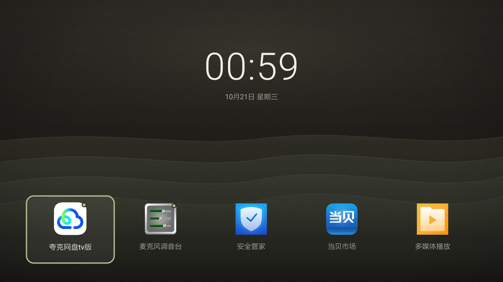
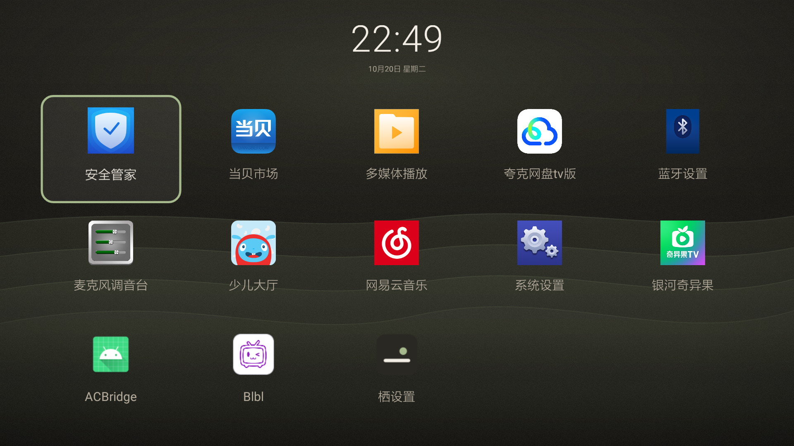
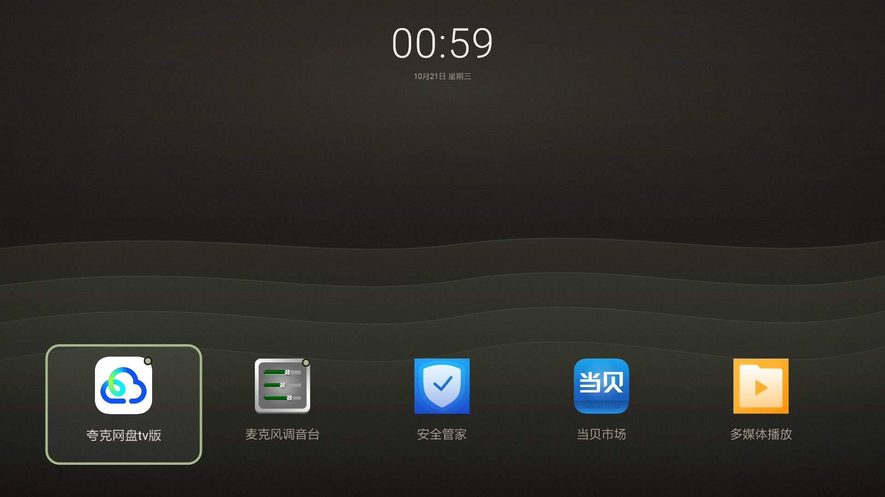
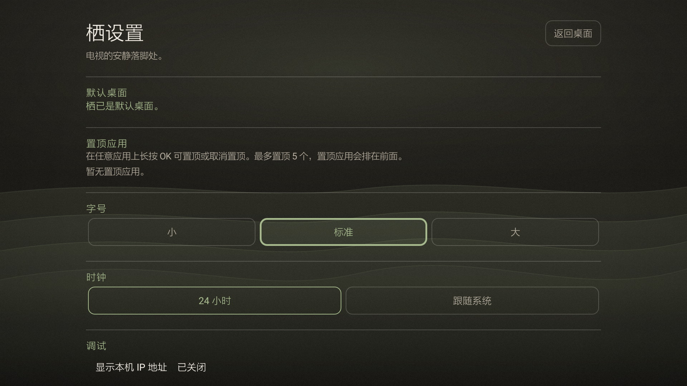

# 栖 Perch

**A quiet perch for your TV.**  
栖，电视的安静落脚处。

Perch is a small, offline home screen for Android TV and TV boxes. The first screen is just the time, the date, and one row of apps. Press ↓ and the row opens into the full app grid. There are no ads, no recommendations, no analytics, and no update service. It is built against the platform APIs with no third-party libraries.



## The idea

Most TV launchers are storefronts. Perch is a place to land: one calm screen, the current time, and the apps you actually use. Everything else stays one deliberate step away.

- The clock is the only large element. No brand banner, no cards, no wallpaper carousel.
- The first row is your pinned apps plus the first alphabetical apps.
- The full grid is revealed only when you ask for it.
- The palette is warm charcoal, ivory, and a single moss accent; the only permanent graphics are app icons.
- The backdrop is drawn at runtime from gradients, four receding ridges, and a fine grain. It ships no image asset and renders from the same relative coordinates at 720p, 1080p, 4K, and 8K.

## Features

- Large 24-hour clock and locale-aware date by default, or follow the system's 12/24-hour setting.
- Compact first screen with five apps; ↓ expands to a 5-column, scrollable grid.
- The clock is one shared element: expanding shrinks it and lifts it to the top while it stays centered, and the grid opens below it.
- ↑ on the first screen opens quick settings: network, Bluetooth, display, sound, accessibility, all settings, and Perch settings.
- Long-press OK on any app to pin or unpin it. Up to five pinned apps move to the front and are marked with a small moss dot.
- Text size presets (small, standard, large) apply to app labels, menus, and settings. The clock size is fixed.
- Optional local IP display for debugging, off by default.
- D-pad first. BACK never exits the home screen; it closes the quick settings or returns from the grid to the large clock.
- Accessibility: 5% safe-area padding, a 3 dp high-contrast focus ring, text at 16 sp or larger, WCAG AA text contrast, one TalkBack description per app, and respect for the system animation scale.
- Adaptive launcher icon, TV banner, English and Simplified Chinese resources.
- A drawn 苔阶 backdrop behind every screen: warm charcoal gradient, one soft light above the clock, four receding ridges, and grain that keeps dark areas from banding.
- No `INTERNET` permission: `ACCESS_NETWORK_STATE` is the only declared permission.

## Screens

| All apps (↓) | Quick settings (↑) | Perch settings |
| --- | --- | --- |
|  |  |  |

## Controls

| Input | First screen | All-apps grid | Quick settings |
| --- | --- | --- | --- |
| ← / → | Move between the five apps | Move within a row | Move between settings shortcuts |
| ↓ | Open all apps | Move down | Close the sheet |
| ↑ | Open quick settings | Collapse from the first row, otherwise move up | — |
| OK | Open the app | Open the app | Open the settings screen |
| Long-press OK | Pin / unpin the app | Pin / unpin the app | — |
| BACK | Stay on the home screen | Collapse to the large clock | Close the sheet |
| HOME | Return to Perch | Return to Perch | Return to Perch |

Pinned apps are sorted alphabetically, followed by the remaining apps. The Perch settings entry is placed last by default in the grid. The five-app first row is filled from this order, so there is no separate dock and no duplicate icons.

## Install

Requires Android 5.0 (API 21) or newer.

1. Download `perch-0.1.0.apk` from the Releases page and verify it against `SHA256SUMS.txt`.
2. Install it:

```bash
adb install perch-0.1.0.apk
```

3. Open **Perch settings** from the app list, or start it directly:

```bash
adb shell am start -n io.github.duanechen520.perch/.SettingsActivity
```

### Make Perch the home app

Try the normal route first:

- **Settings → Apps → Default apps → Home app → Perch**, or
- press **HOME**, choose **Perch**, and pick **Always** if your device shows a chooser.

Vendor firmware sometimes hides the home-app picker. On those devices, the home intent can be redirected by disabling the stock launcher for the current user:

```bash
# This package name is device-specific; find yours first.
adb shell pm list packages | grep -i launcher

# Advanced: keep the package name so you can undo this.
adb shell pm disable-user --user 0 <stock.home.package>
adb shell am start -a android.intent.action.MAIN -c android.intent.category.HOME
```

To undo:

```bash
adb shell pm enable --user 0 <stock.home.package>
```

Disabling the stock launcher without a working alternate home app can leave the device without a usable home screen. Keep a way to re-enable it.

## Package and updates

- Application ID: `io.github.duanechen520.perch`
- Minimum SDK: 21 · Target SDK: 34
- Current version: `0.2.0`
- Release signing certificate SHA-256 fingerprint: `FB:85:AF:D4:3E:97:9C:AF:68:68:59:DA:2A:A5:37:71:F1:7A:2D:E0:D9:57:6C:B5:3B:64:80:55:8F:3E:FD:21`

Future releases will use the same signing key, so updates can be installed over this version. Do not install a locally built debug APK over a release build: Android rejects updates signed by a different key.

## Privacy

- Perch does **not** declare the `INTERNET` permission and contains no networking code.
- The only declared permission is `ACCESS_NETWORK_STATE`, a normal permission used solely to read the local IPv4 address for the optional IP display.
- No analytics, crash reporting, advertising SDKs, or telemetry.
- The local IP display is off by default and never leaves the device.
- Settings and pins are stored locally in the app's private storage.

## Accessibility

- 5% safe-area margins for overscan.
- A 3 dp moss focus ring, plus a slight scale change on D-pad focus; the scale is skipped when animations are disabled.
- WCAG AA contrast for body text and key labels, including the optional IP text and section headings.
- In settings, the selected option keeps its own fill and color while focused, so the current value stays readable during D-pad navigation.
- No text below 16 sp in the launcher UI. Three text-size presets are available.
- App labels wrap to two lines instead of shrinking.
- Every app tile has a single accessibility description; pinned apps include their pinned state.
- The quick-settings sheet blocks the background from accessibility focus while open.
- The quick-settings, focus, and expand/collapse animations honor the system animator duration scale.

A full TalkBack screen-reader pass on a TV remote has not been performed. Visible focus, content descriptions, contrast, and text sizes have been checked on the test device.

## Build

Requirements:

- JDK 17
- Android SDK with **Platform 34** and **Build-Tools 34.0.0** (or set `ANDROID_PLATFORM` / `BUILD_TOOLS`)
- Git Bash, WSL, Linux, or a macOS shell environment

```bash
export ANDROID_HOME=/path/to/android-sdk
bash build.sh
```

Without release-key settings, the script generates a local debug key under `signing/` and produces:

```
dist/perch-0.1.0-debug.apk
```

For a release build, supply your own key and never commit it:

```bash
export PERCH_KEYSTORE=/secure/path/perch-release.jks
export PERCH_KEY_ALIAS=perch
export PERCH_KS_PASS='your-store-password'
export PERCH_KEY_PASS='your-key-password'
bash build.sh
```

The script uses `aapt2`, `javac --release 8`, `d8`, `zipalign`, and `apksigner` directly. It does not use Gradle. Keep the release key backed up; Android will not install updates signed by a different key for the same application ID.

The launcher icon and TV banner can be regenerated with `tools/make_assets.ps1` (Windows, System.Drawing). The generated assets are committed.

## Project layout

```
AndroidManifest.xml                         app, permissions, components, queries
src/io/github/duanechen520/perch/
  MainActivity.java                         home screen, grid, quick settings
  SettingsActivity.java                     settings and pinned-app management
  AppRepository.java                        app discovery, ordering, pin storage
  TypeScale.java                            text-size presets
  WallpaperBackground.java                  drawn 苔阶 backdrop, no image assets
res/                                        layout-free UI resources, icons, strings (en / zh-CN)
tools/make_assets.ps1                       optional icon / banner generator (Windows)
build.sh                                    dependency-free build script
docs/                                       screenshots used by this README
```

## Status and limits

`0.2.0` has been tested on an **Android 5.1.1 (API 22), Amlogic S905M-class TV box** at 1920×1080, and at a forced 1280×720, with a D-pad remote. It installs, becomes the default home app, survives a real reboot, and the tested interactions above work on that device. On that box, cold start measured 444–566 ms, idle CPU 0% with the clock running, resident memory about 39 MB, and expand/collapse frames 13–31 ms — the same range as `0.1.0`, so the drawn backdrop does not add measurable jank there.

It has **not** been runtime-tested on a modern Android TV / Google TV device yet. The manifest targets API 34 and includes `<queries>` for package visibility; home-app replacement behavior still varies by vendor firmware.

Known limitations:

- Launchable activities only; apps without a launcher activity are not shown.
- No app hiding, manual reordering, folders, search, widgets, or system-wallpaper integration. Pinned apps are the only ordering control, and the backdrop is not user-selectable.
- The grid always uses five columns. The first row keeps five slots, so a device with fewer than five apps shows space rather than stretched tiles; layout for very small or very large screens has not been tuned.
- The backdrop is drawn from relative coordinates and was rendered offscreen at 3840×2160 and 7680×4320 while it was being developed, but Perch has not been run on a 4K or 8K panel.
- The optional IP display is a developer aid, not a network-status UI.
- System settings shortcuts depend on which Settings activities the device exposes.
- Accessibility descriptions and focus order are in place, but nothing has been verified with TalkBack or another screen reader.

## Contributing

Issues and pull requests are welcome. Please include the device model, Android version, and whether the stock launcher could be replaced. Keep the project free of third-party dependencies, avoid unnecessary UI chrome, and test the D-pad paths on a real device or TV emulator.

## License

Licensed under the [Apache License 2.0](LICENSE). See [NOTICE](NOTICE).

App icons and app names shown in the screenshots belong to their respective applications and are not distributed with this project. Android TV and Google TV are trademarks of Google LLC. This is an independent project and is not affiliated with Google, Alibaba, Tmall, or any TV vendor.

---

## 中文简介

**栖（Perch）** 是一个安静、离线、无广告的 Android TV 桌面。

首屏只有大时钟、日期和一排应用；按 ↓ 展开全部应用（时钟是同一个视图连续缩小上移、始终居中，应用矩阵从它下方展开），按 ↑ 打开顶部快捷设置，长按 OK 可在最多 5 个范围内置顶应用，BACK 从列表回到大时钟。字号支持小、标准、大三档，时钟支持 24 小时或跟随系统，本机 IP 显示仅作为默认关闭的调试选项。

它不申请 INTERNET 权限，没有广告、遥测、推荐位和第三方 SDK；唯一权限是用于读取本机 IP 的 `ACCESS_NETWORK_STATE`。界面使用 5% 安全边距、3dp 焦点环、不低于 16sp 的文字和高对比度配色，并为每个应用提供单条无障碍描述。背景「苔阶」由 Canvas 渐变、四道山脊与细颗粒实时绘制，不打包任何图片资源，720p 到 8K 共用同一套比例坐标。

安装后可在系统「设置 → 应用 → 默认应用 → 主屏幕应用」中切换，或在部分设备上按 HOME 键选择栖。当前 0.2.0 已在 Android 5.1.1（API 22）的 Amlogic S905M 电视盒上实机验证（1080p 与强制 720p），并作为默认桌面通过真实重启测试；现代 Android TV 设备尚未实机测试。

构建需要 JDK 17 与 Android SDK Platform 34，运行 `bash build.sh`。
